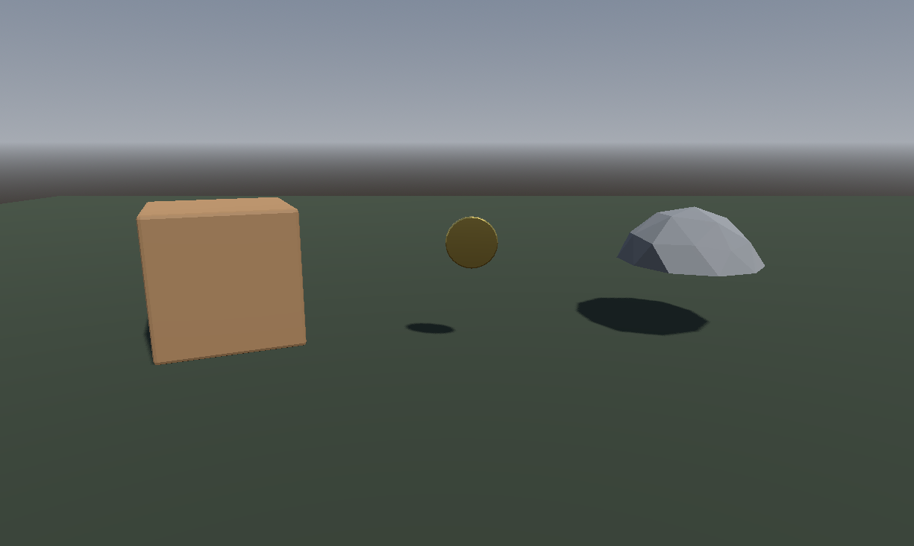

# Blender → Godot pipeline (prop pack)

This document records the pipeline that produced the three showcase props, as
run through Blender MCP and the Godot AI Bridge with the **Blender Skills** and
**Godot Skills** skill sets active.



## Production brief

| Item | Decision |
|---|---|
| Type | Three low-poly props for a showcase scene |
| Target | Godot 4.7, project `مشروع-لعبة-جديد` |
| Style | Low-poly, flat-shaded, single PBR material per asset |
| Poly budget | Small/background tier: crate ≤ 900, coin ≤ 500, rock ≤ 450 |
| Textures | None; solid Principled BSDF colors, metallic-roughness only |
| Export | GLB, +Y up, modifiers applied, transforms applied |
| Pivot | Floor center (`origin_to_floor`), 1 unit = 1 m |
| Naming | `COL_Showcase`, `SM_*`, `MAT_*` per naming-conventions |

## Assets

| Mesh | Material | Triangles | GLB |
|---|---|---|---|
| `SM_Prop_Crate_Wood_01` | `MAT_Prop_Crate_Wood` | 108 | `assets/models/sm_prop_crate_wood_01.glb` |
| `SM_Prop_Crate_Wood_01_COL` | — (collision proxy) | 12 | inside the crate GLB |
| `SM_Prop_Coin_Gold_01` | `MAT_Prop_Coin_Gold` | 284 | `assets/models/sm_prop_coin_gold_01.glb` |
| `SM_Env_Rock_01` | `MAT_Env_Rock_Grey` | 80 | `assets/models/sm_env_rock_01.glb` |

Total visible geometry: 472 triangles across three props. Every asset passed the
optimization gate: applied scale/rotation, flat shading, one material, smart-UV
unwrapped, floor pivot.

## Export contract (`godot-export`)

```python
bpy.ops.export_scene.gltf(
    filepath=path,
    export_format='GLB',
    use_selection=True,
    export_yup=True,
    export_apply=True,
    export_materials='EXPORT',
)
```

Selection-only export keeps the Blender scene's own objects out of the file, and
the `_COL` collision companion ships inside the crate GLB so the naming contract
travels with the mesh.

## Godot scene

`scenes/showcase_3d.tscn`

```
Showcase3D (Node3D)            scripts/showcase_3d.gd
├── WorldEnvironment           clear procedural sky
├── Camera3D                   fov 50, current
├── SunLight (DirectionalLight3D)  shadows on
├── Ground (MeshInstance3D)    24 × 24 PlaneMesh, dark green standard material
└── Props (Node3D)
    ├── Crate  ← sm_prop_crate_wood_01.glb
    ├── Coin   ← sm_prop_coin_gold_01.glb   (floats and bobs)
    └── Rock   ← sm_env_rock_01.glb
```

`scripts/showcase_3d.gd` turns each prop on its own axis and bobs the coin, using
typed `@export` values so the motion is tunable from the inspector.

## Verification

- Blender: three GLBs exported (10.4 KB / 19.8 KB / 6.5 KB), 472 triangles total,
  all transforms unit-scaled, materials named `MAT_*`.
- Godot: all three GLBs imported as `PackedScene`; scene saved; cinematic capture
  rendered through the camera; the scene ran live for 140 frames with no runtime
  errors in the game log; frame captured from the live window.
- Asset check inside Godot: scale reads correctly at 1 unit = 1 m (1 m crate next
  to a 0.36 m coin), materials import as PBR, no missing textures.

## Reproducing

1. Open the project in Blender and keep the MCP extension server running.
2. Build or edit assets in `COL_Showcase`, keep `SM_*` / `MAT_*` naming.
3. Export each asset with the selection-only GLB call above into
   `assets/models/`.
4. In Godot, let the editor import the GLB, then instance it under
   `Showcase3D/Props`.

## Integration into the game

The assets are playable from the main menu, not only from the standalone scene.

| Change | File |
|---|---|
| `BonusButton` ("مستوى المكافأة 3D") right under "ابدأ المغامرة" | `scenes/main.tscn` |
| Connect + `_on_bonus_pressed()` that loads the bonus level | `scripts/ui/title_screen.gd` |
| Playable 3D level | `scenes/bonus_3d.tscn` |
| Movement, camera, coin pickup, fall respawn, Esc-to-menu | `scripts/bonus_3d.gd` |

`scenes/main.tscn` also gained `unique_id` attributes on every node: Godot 4.7
rewrites them whenever the editor saves the scene. No existing node, property or
connection changed.

### Bonus level

```
Bonus3D (Node3D)
├── WorldEnvironment        procedural sky
├── Sun (DirectionalLight3D)
├── Ground (StaticBody3D)   30 × 30 plane + box collider
├── Player (CharacterBody3D)  capsule + capsule collider
├── Camera3D                 follows the player
├── Crate1..3               GLB instances + box colliders
├── Rock1..2                GLB instances
├── Coin (Area3D)           GLB coin, collected on touch
└── UI (CanvasLayer)        hint + status labels (Arabic theme)
```

**Controls:** WASD / arrows to move, Space to jump, Q/E to orbit the camera,
Esc to return to the menu. Walking off the 30 × 30 ground teleports the hero back
to the spawn point.

### Verified flow

1. Main menu shows the new button below "ابدأ المغامرة".
2. Keyboard Down + Enter on that button loads `bonus_3d.tscn`.
3. The hero stands on the ground, crates rotate, the coin bobs.
4. Walking moves the hero in camera space.
5. Esc returns to the main menu.

